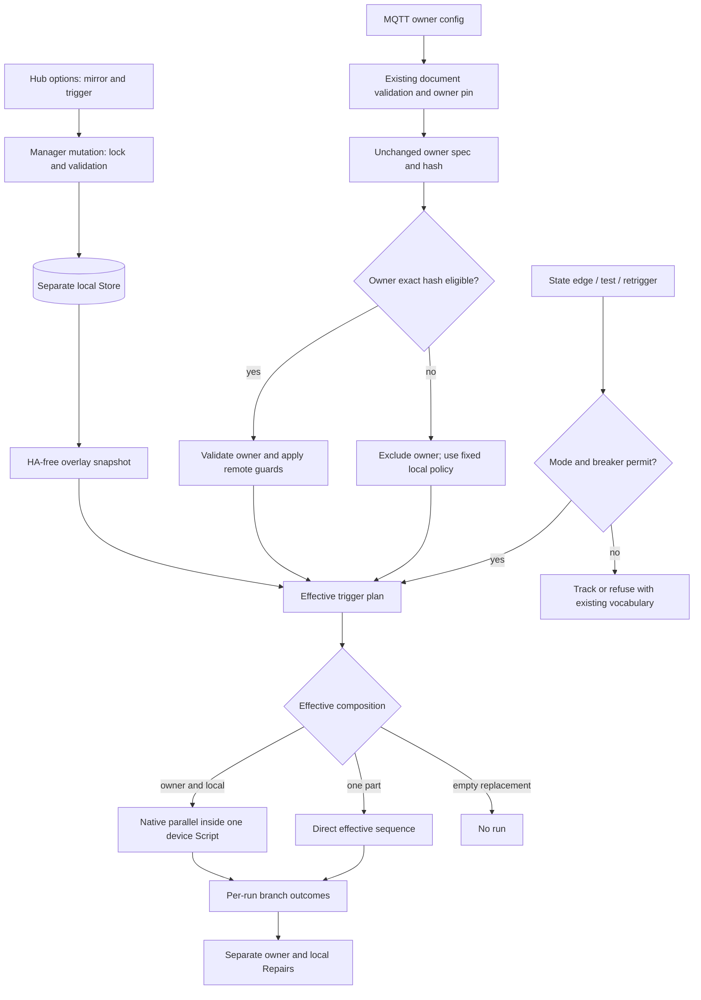

# Phase 11: Local Actions on Mirrors - Research

**Researched:** 2026-10-17  
**Domain:** Home Assistant custom integration execution, local persistence, options flows and trust boundaries  
**Confidence:** MEDIUM overall; installed-Core behavior experimentally pinned; actual bench rendering pending.

<user_constraints>
## User Constraints (from CONTEXT.md)

The following material is copied verbatim from the phase context. [VERIFIED: .planning/phases/11-local-actions-on-mirrors/11-CONTEXT.md:16-54,114-117]

<!-- DATA_8C4A27F1_START -->
### Locked Decisions

### Carried forward from requirements and owner decisions of 2026-10-11
- **D-01:** One Script per device. In additive mode, owner and local actions run in parallel inside that Script; a runtime failure in either branch does not prevent the other. Run mode and breaker remain device-wide. No separate local Script and no step-level patches.
- **D-02:** Owner actions require approval of their exact actions hash. Local actions run independently of pending, blocked or empty owner actions, with owned-device trust: no GuardedTemplate or remote-action denylist on local actions. Apply static denial and runtime guards to the owner branch only, before assembly.
- **D-03:** While owner actions are unapproved, use safe defaults for local execution instead of owner-provided run_on_startup, run mode and breaker limits. Observe/disabled modes and breaker apply; a local edit releases a tripped breaker. Test buttons and re-trigger use effective actions, with no new broker status/reason words.
- **D-04:** Local actions never enter central config, actions hash, exports, diagnostics content or adoption payload. Existing approvals remain valid. Diagnostics expose counts only, including per-device and orphaned counts. Replacing triggers locally leaves approval pending and does not permit adoption of unapproved owner actions.
- **D-05:** Local actions survive owner content/name/revision changes, restarts and owner re-pins. Removed Select options remain inactive and automatically reattach when the same StateValue returns. Tombstones and adoption discard local actions with a log entry; adopt_device reports the discard. Startup and transient prune never discard them.
- **D-06:** UI lives in a menu in the hub options flow, never a new config subentry type. All new UI texts exist in English and German. README covers add/replace, mute, parallel execution, lifecycle, downgrade and the {{ state }} template caveat.

### Storage, removal and downgrade
- **D-07:** Store local actions in a separate HA Store file. v1.0.1 ignores it and does not execute local actions; after upgrading again, saved local actions are available. Do not use an additive key in the existing main Store, which older versions drop on save.
- **D-08:** Removing the whole integration deletes its local Store, including when shared devices are retained. The removal warning includes the number of devices whose local actions will be deleted, e.g. 3 devices, rather than only a generic warning.
- **D-09:** README and release notes carry a prominent downgrade warning: v1.0.1 ignores local replacement and mute settings, so approved owner actions may run again. A downgrade round trip on the real bench remains deferred as MIR-F4; do not claim it has been verified.

### Trigger identity and orphaned options
- **D-10:** Stored identity is device ID plus device kind plus StateValue. Preserve existing state normalization; display-name edits retain identity. Matching StateValues across Switch and Select must not share local actions accidentally.
- **D-11:** Select trigger labels show friendly name and StateValue, e.g. Gemütlich (`cozy`). Retain the last known friendly name for orphaned options and label them as no longer present on the owner.
- **D-12:** Users can view, edit or delete orphaned local actions. Editing does not activate them; they stay inactive until their matching option returns. Keep kind-mismatched records inactive under the same identity rule, rather than applying them to another device kind.

### Editing flow
- **D-13:** Navigate hub options → mirrored device → trigger. Save mode and actions per trigger, apply immediately without restart, then return to trigger selection. Cancelling discards only the current unsaved edit, not already saved trigger changes.
- **D-14:** A dedicated Remove local customization entry removes the mode and local actions after confirmation. This restores owner-only behavior subject to approval. Keep removal distinct from an empty replacement, which mutes the trigger locally.
- **D-15:** New local customizations preselect In addition to. Saving Instead of with no local actions requires a separate confirmation stating that the trigger will execute no actions on this instance.

### Notices and local failures
- **D-16:** Trigger selection shows the mode directly: additional, instead of owner actions, or locally muted. Orphan labels retain the identifying name and StateValue.
- **D-17:** The owner approval issue includes the replaced-trigger count and explicitly explains that local actions may already run and that approval concerns owner actions only. Do not imply local replacements grant approval.
- **D-18:** Local action failures raise one Repairs issue per device, independent of owner failure issues. It names the latest failed local trigger and its error.
- **D-19:** Clear that local issue only when its affected local trigger successfully runs or its local customization is removed. A successful different trigger or owner branch does not clear it. Preserve existing protection against dropped, cancelled or superseded runs masquerading as success.

### Research and planning constraints carried forward
- **D-20:** Research must pin core 2026.9.4 parallel behavior, including stop, continue_on_error, response variables and exception propagation after both branches finish. If semantics conflict with D-01, return to the owner before any sequential fallback.
- **D-21:** Invariant tests first: hash equality, adoption payload bytes, approval-state × local-mode × owner-actions gate matrix (4×3×2), and every fake-broker publish checked for local-content leakage. Then HA-free overlay module and plan-based runner assembly; owned and overlay-free mirror sequences stay byte-identical to existing behavior. Next manager wiring, then thin options-flow client, translations, approval text and README.
- **D-22:** Load overlays before restoring mirrors; persist edits under the manager lock with an immediate save; no startup garbage collection. Research a separate Store skeleton with its own migration function and early bench rendering of section plus ActionSelector on the 2026.9 frontend.
- **D-23:** Add a security threat entry for trust-level mixing within one Script. End Phase 11 with milestone-wide cross-file review so product fixes land before Phase 12. Existing native migration and shared-topic invariants remain unchanged.

### Implementation discretion

- Exact Store key/schema and migration mechanics, module/API names, plan splits, bounded diagnostics counts and translated wording are implementation details, subject to the decisions above.
- Research must select and justify safe local execution defaults under MIR-11. No numerical defaults were chosen in this discussion.
- The user selected concrete options throughout; no product decisions were explicitly delegated.

### Deferred Ideas (OUT OF SCOPE)

None introduced in discussion. Existing roadmap deferrals remain: local actions on owned devices, local action export/import, richer re-trigger acknowledgements and the real-bench downgrade round trip. No pending todos matched this phase.
<!-- DATA_8C4A27F1_END -->
</user_constraints>

## Summary

Use an HA-free overlay model and effective execution plan beside the unchanged owner DeviceSpec. Validate and guard the owner branch independently, validate the trusted local branch without the remote denylist, and assemble native parallel branches only where both parts actually run. Retain the existing raw dispatcher exactly for owned devices and mirrors without customization. The current runner validates the trigger, then validates its choose dispatcher, and currently applies the guard to the entire dispatcher; that last operation must move to the owner portion for customized mirrors. [VERIFIED: custom_components/mqtt_actions/runner.py:48-135; custom_components/mqtt_actions/actions.py:21-31; custom_components/mqtt_actions/trust.py:95-112]

**D-01 can hold.** An executable ten-case probe against the installed Home Assistant 2026.9.4 confirms native parallel completes both branches before forwarding the first exception in branch order. A normal stop or error-stop also waits for the sibling, then stops the enclosing Script. In particular, owner stop can mask a local exception at the outer API. Independent local Repairs therefore need per-run, per-branch outcome inspection, rather than trusting the outer exception or non-None result. The probe also proves owner-only GuardedTemplate enforcement leaves trusted local calls unrestricted. [VERIFIED: 11-parallel-probe.jsonl:1-10; installed homeassistant/helpers/script.py:483-535,601-638,710-727,1016-1036]

Use a separate HA Store, load it before restoring mirrors, and make deletion cause explicit. Existing mirror removal is shared by tombstones and prune; unconditionally deleting overlays there would violate D-05. Frontend source and backend schema support the intended form ingredients, but no real-bench browser check was performed. Put a small section plus ActionSelector rendering experiment early in implementation, before the full flow is built. [VERIFIED: custom_components/mqtt_actions/sync.py:280-309,487-499; custom_components/mqtt_actions/manager.py:770-795,1548-1581; installed homeassistant/data_entry_flow.py:933-957; installed homeassistant/helpers/selector.py:268-286] [CITED: https://contributors.home-assistant.io/core/integrations/flow-steps/]

**Primary recommendation:** preserve owner content as immutable input, derive an effective local execution plan, and pin native parallel outcomes before manager wiring.

## Architectural Responsibility Map

Recommended ownership, constrained by D-01 through D-23:

| Capability | Primary Tier | Secondary Tier | Rationale |
|------------|-------------|----------------|-----------|
| Edit and render local actions | Browser/client, HA frontend | Backend options flow | Frontend renders the standard selector; manager validates every mutation. |
| Approval, denial and effective plan | Integration backend | HA Script engine | Trust cannot depend on the form; owner eligibility is separate from local eligibility. |
| Queue, restart and parallel execution | HA Script engine | Integration runner | One integration-owned top-level Script retains device-wide scheduling. |
| Startup/mode/breaker gates | Integration manager | State tracker | Apply local fixed policy when the owner hash is ineligible. |
| Local durable overlays and migration | HA Store | Manager under its lock | Store raw actions independently from shared content. |
| Shared documents and broker acknowledgements | Existing integration transport | Broker | Publish only existing contracts; no local action data. |
| Local errors and approval notices | Integration runner/manager | HA Repairs frontend | Separate issue families, exact affected-trigger recovery. |
| Diagnostics | Integration backend | HA diagnostics | Construct explicit counts without reading action content. |

[VERIFIED: .planning/phases/11-local-actions-on-mirrors/11-CONTEXT.md:17-49]

## Project Constraints (from AGENTS.md)

- Use Python 3.14.2 or newer and uv; install the existing environment with `uv sync --locked`. [VERIFIED: AGENTS.md:9-19] <!-- DATA_14E56D72_START --> Verbatim: “Use Python 3.14.2 or newer and `uv`”, “`uv sync --locked`”. <!-- DATA_14E56D72_END -->
- Keep production code typed, use four spaces, descriptive docstrings, snake_case functions/modules, PascalCase classes and uppercase constants; Ruff targets Python 3.14 and 120 characters. [VERIFIED: AGENTS.md:23-25]
- Reuse shared pytest/PHACC fixtures, automatic asyncio mode, behavior-oriented tests, and regression tests for fixes. File/test naming follows the existing conventions. [VERIFIED: AGENTS.md:27-31]
- Run Ruff lint and format checks, all applicable unit/broker/multi-instance tiers, hassfest and HACS validation. Real-broker CI must require Mosquitto rather than silently accepting skips. [VERIFIED: AGENTS.md:13-19,31,35]
- Keep focused conventional commits and PR descriptions stating the problem, resulting behavior and validation; include screenshots for visible UI changes. [VERIFIED: AGENTS.md:33-35]
- Follow the existing integration/platform/module structure; there is no separate build step. [VERIFIED: AGENTS.md:3-7,21]
- The primary integration skill requires established HA patterns and behavior tests; its Repairs guidance asks for actionable explanations and its diagnostics guidance excludes sensitive data. [VERIFIED: /home/akentner/.agents/skills/home-assistant-integration-knowledge/SKILL.md:10-40; /home/akentner/.agents/skills/home-assistant-integration-knowledge/platform-repairs.md:5-21; /home/akentner/.agents/skills/home-assistant-integration-knowledge/platform-diagnostics.md:3-6]

Project skill-directory discovery returned neither local skill directory; the agent-skills config is empty. Graph status returned no graph. These are session observations, not compatibility constraints. [VERIFIED: research session directory discovery and graphify status; .planning/config.json:64-76] <!-- DATA_513E9AD7_START --> Verbatim configuration: `"agent_skills": {}`. <!-- DATA_513E9AD7_END -->

<phase_requirements>
## Phase Requirements

Descriptions below are copied from the requirements file. [VERIFIED: .planning/REQUIREMENTS.md:29-43]

<!-- DATA_3157B8C4_START -->
| ID | Description | Research Support |
|----|-------------|------------------|
| MIR-01 | On a follower, the user sets local actions per trigger of a mirrored device (switch on/off, each Select option) with mode "in addition to" or "instead of" the owner's actions, from the integration's options | Thin manager-backed hub options flow; section/selector smoke gate. |
| MIR-02 | Local actions run without approval, also while the owner's actions are pending, blocked or empty; the owner's actions still run only when their exact hash is approved | Separate owner eligibility from effective local runnability; owner-only validation and guards. |
| MIR-03 | In "in addition to" mode, owner and local parts run in parallel within the device's single Script; a runtime failure of one part does not stop the other; run mode and breaker stay device-wide | Native parallel pin; branch trace reduction; single device queue/restart and breaker. |
| MIR-04 | Local actions never leave the instance: they are not in the central config, the actions hash, the export, diagnostics content or the adoption payload; existing approvals stay valid | Unmodified owner spec; wire/hash/adoption invariants; global publish sentinel. |
| MIR-05 | An empty "instead of" mutes the trigger on this instance | Persist replacement presence independently of nonempty actions; explicit mute confirmation. |
| MIR-06 | Local actions survive owner content changes, renames, rev bumps, restarts and an owner re-pin | Separate durable overlay Store; stable identity; no owner-update cleanup. |
| MIR-07 | Local actions of a Select option the owner removed are kept inactive, shown as orphaned in the flow, removable there, and re-attach when the same StateValue returns | Orphan records and last label retained; inactive matching and automatic reattachment. |
| MIR-08 | On a tombstone or an adoption, local actions are discarded and logged; `adopt_device` reports it in its response; nothing is discarded at start-up or on a transient prune | Explicit removal cause; tombstone/adoption deletion and response; prune retention. |
| MIR-09 | Device mode (observe, disabled) and the circuit breaker apply to local actions; a local edit releases a tripped breaker | Effective policy and manager gates; local edit releases breaker. |
| MIR-10 | Test buttons and the re-trigger service run the effective actions on this instance; no new status or reason words appear on the broker | Common effective trigger plan for state/test/retrigger; existing wire vocabulary. |
| MIR-11 | While the owner's actions are unapproved, `run_on_startup`, run mode and breaker limits from the owner's document do not govern local runs; safe defaults apply | Locally fixed startup/queue/breaker defaults while owner hash ineligible. |
| MIR-12 | The approval issue shows how many triggers are replaced locally; the approval state stays pending and adoption stays refused | Owner approval view retains original hash and adds replacement count. |
| MIR-13 | Local action failures raise their own Repairs issue, independent of owner action failures | Per-device local issue with per-trigger outcome/generation protection. |
| MIR-14 | Diagnostics show counts of local actions (per device, orphaned), never their content | Count-only allow-listed diagnostics, including retained inactive records. |
| MIR-15 | README documents modes, mute, parallel semantics, lifecycle (orphan, tombstone, adoption), downgrade behavior and the `{{ state }}` template caveat; UI texts exist in en and de | Bilingual flow/issue texts; README behavior and prominent downgrade warning. |
<!-- DATA_3157B8C4_END -->
</phase_requirements>

## Standard Stack

Use the existing lockfile; this phase requires no new external packages. These are installed versions observed through importlib.metadata and CLI probes, not recommendations to upgrade to current registry releases. Package publication dates were not researched because no dependency update is in scope. [VERIFIED: research session version probes; pyproject.toml:1-23]

| Component | Observed version | Purpose | Planning instruction |
|-----------|------------------|---------|----------------------|
| Python | 3.14.7 | Runtime | Meets the explicit repository minimum. |
| Home Assistant Core | 2026.9.4 | Script, Store, selector, Repairs | Pin contracts against the actual installed source and maintained tests. |
| pytest-homeassistant-custom-component | 0.13.367 | HA test fixtures | Reuse the installed pinned development dependency. |
| pytest | 9.0.3 | Behavior and core-contract tests | Keep automatic asyncio mode. |
| Ruff | 0.16.10, project pin | Lint/format | Use repository configuration. |
| uv | 0.12.7 | Environment and commands | Keep lockfile unchanged. |

[VERIFIED: research session version probes; pyproject.toml:4,10-23]
<!-- DATA_A7E1D490_START -->
Verbatim dependency/config values: `requires-python = ">=3.14.2"`, `asyncio_mode = "auto"`, `"pytest-homeassistant-custom-component==0.13.367"`, `"ruff==0.16.10"`.
<!-- DATA_A7E1D490_END -->

Supporting APIs: HA Store subclass migration, ActionSelector, section, issue registry, Script, and a transient trace collector. Do not add an alternative executor, persistence library, frontend package or separate config-subentry type. [VERIFIED: installed homeassistant/helpers/storage.py:225-241,433-460,620-631; installed homeassistant/helpers/selector.py:268-286; installed homeassistant/data_entry_flow.py:933-957; custom_components/mqtt_actions/runner.py:5-7; phase context D-01,D-06,D-07,D-22]

### Package Legitimacy Audit

Not applicable: no new external package installation is recommended. Existing locked dependencies are retained. Do not infer that this is a fresh registry-legitimacy audit. [VERIFIED: pyproject.toml:19-23]

## Architecture Patterns

### System Architecture Diagram

Recommended flow:



The graph is a proposed design, not a claim that these new components already exist.

### Component Responsibilities

Use proposed new pure overlay and Store modules; names and key/schema are implementation discretion. Existing modules remain the integration seams. [VERIFIED: phase context D-21,D-22 and implementation discretion]

| Component | Responsibility |
|-----------|----------------|
| Pure overlay model, proposed | Raw record parsing, normalized identity, active/orphan matching, last label, effective plan, count summaries. No HA imports. |
| Local Store subclass, proposed | Separate format/version, explicit migration function, load/save/remove, raw serializable copies. |
| Manager | Own records and mutation APIs, lock, policy selection, lifecycle causes, rebuilds and approval notices. |
| Runner | Validate each trust domain, compose plan, retain one top-level Script, reduce per-run branch outcomes. |
| Options flow | Thin client; submit edits to manager, preserve committed changes across navigation. |
| Services/retrigger | Existing shared action path and unchanged broker vocabulary; adoption response reports local discard. |
| Diagnostics/Repairs/translations/docs | Count-only summaries, independent local issue, bilingual UI, changed contract explanations. |

### Pattern 1: Keep owner content immutable

Never mutate the mirrored spec, its nested action lists, received document or adoption content to install local actions. Build a separate runtime plan from copies. Current document building, actions hashing and adoption all consume the original spec; replacing its actions would leak local content and invalidate approvals. [VERIFIED: custom_components/mqtt_actions/document.py:100-152,171-190; custom_components/mqtt_actions/manager.py:1233-1240]
<!-- DATA_6A81D5F0_START -->
Verbatim hashing mapping: `([trigger.value.lower(), trigger.actions] for trigger in spec.triggers.values())`; verbatim adoption content: `subentry_payload(build_content(spec), device_id)`.
<!-- DATA_6A81D5F0_END -->

Keep “no customization” distinguishable from “replacement with an empty action list.” The latter intentionally suppresses the owner, while deleting the record restores owner-only behavior. Do not use truthiness of local actions to choose the mode. [VERIFIED: phase context D-14,D-15]

### Pattern 2: Owner-only restriction before assembly

Current restriction code wraps every validated service-name Template in a copied tree. The denial exception deliberately bypasses ordinary continue-on-error handling. The probe demonstrates that applying that wrapper only to the owner subtree blocks a templated denied owner call while the identical trusted local service executes. [VERIFIED: custom_components/mqtt_actions/trust.py:60-112; 11-parallel-probe.jsonl:10]
<!-- DATA_E4563AB8_START -->
Verbatim guard keys: `GUARDED_KEYS = ("action", "service", "service_template")`. Verbatim exception declaration: `class DeniedServiceCallError(Exception):`. Probe exception: `"DeniedServiceCallError:service mqtt.publish is not allowed for mirrored actions"`.
<!-- DATA_E4563AB8_END -->

Recommended assembly order:

1. Derive owner eligibility from original approval/hash and static analysis.
2. Validate owner and local raw sequences independently, isolating setup failures.
3. Compose and perform any required final HA validation.
4. Apply guard_actions only to the final validated owner subtree; never revalidate after guarding unless a contract test proves the wrapper survives.
5. Construct one device Script from the validated plan.

A denied or locally invalid owner branch must not prevent a valid local branch from compiling. A malformed local branch must not make eligible owner actions disappear. Preserve existing direct assembly when no customization exists. [VERIFIED: phase context D-01,D-02,D-21; custom_components/mqtt_actions/runner.py:62-87,101-135]

### Pattern 3: Pin the real parallel contract

The probe was executed as a temporary program outside tracked tests and copied here as reproducible research evidence. No production source or tracked test file was modified. Re-run from the repository root with the installed interpreter, passing the evidence script filename as the argument. This is a probe, not yet the required permanent behavioral regression suite. [VERIFIED: research session execution; 11-parallel-probe.py:1-66]

| Case | Observed result | Required planning consequence |
|------|-----------------|-------------------------------|
| Owner runtime failure, delayed local branch | Local finished before outer HomeAssistantError. | Native parallel supplies sibling isolation. |
| Both branches fail | Both executed; owner exception forwarded because its branch comes first. | Outer exception cannot report both failures. |
| Normal stop | Local finished; outer run stopped before following action. | Do not describe stop as “only stopping its own branch.” |
| Error-stop | Local finished; result returned, with error recorded in trace. | Non-None result alone is insufficient evidence of success. |
| continue_on_error with HomeAssistantError | Branch continued, sibling completed, outer following action ran. | Retain authored HA error-handling semantics. |
| stop with response_variable | Sibling completed; outer service response came from the stopping branch. | Do not treat responses as independent branch-result channels. |
| Distinct service response variables | Both response dictionaries remained available. | Recommend distinct response-variable names. |
| Same response variable | Second assignment was visible in the observed run. | Shared namespace; ordering is not a supported coordination mechanism. |
| Owner normal stop plus local failure | No outer exception; local failure remained in local branch trace. | Local Repairs must inspect branch outcomes. |
| Guarded owner plus unrestricted local | Local call executed; owner denial propagated despite continue_on_error. | Apply trust guards only to owner. |

[VERIFIED: 11-parallel-probe.jsonl:1-10; installed homeassistant/helpers/script.py:483-535,601-638,710-727,1016-1036; installed homeassistant/helpers/script_variables.py:203-238]

The implementation uses a gather that returns exceptions, then scans its results in branch order. Native parallel internally constructs child Scripts; D-01 means one integration-owned top-level scheduler per device, not forbidding HA's own internal child implementation. Do not construct a second independently scheduled local Script. [VERIFIED: installed homeassistant/helpers/script.py:710-727,2222-2243]
<!-- DATA_8F792E16_START -->
Verbatim installed source: `return_exceptions=True,`; `for result in results:`; `if isinstance(result, Exception):`; `raise result`; `top_level=False,`.
<!-- DATA_8F792E16_END -->

The official parallel guide independently confirms sibling failure isolation and warns about variable collisions. The behavioral source of truth for this phase remains the installed target and permanent pins, because public docs currently show a newer release. [CITED: https://www.home-assistant.io/building-blocks/parallel/]

**D-01 disposition:** compatible with the observed target. No sequential fallback and no owner decision to change topology are required by these findings. If the permanent pin later fails on a different Core build, stop and return to the owner as D-20 requires.

### Pattern 4: Per-branch failure attribution without patching action steps

Use one fresh, task-local Core trace collector around each composite run. Record the assembler's branch paths in the plan, then reduce errors from those paths after the entire parallel action settles. A single outer exception loses the second branch error and can lose all outward indication of a local failure when an earlier owner stop is forwarded. The probe retains both failures and the stop-masked local failure in separate trace paths. [VERIFIED: 11-parallel-probe.jsonl:2,9; installed homeassistant/helpers/trace.py:101-119,237-265]
<!-- DATA_9ED4A72B_START -->
Verbatim probe paths: `"0/parallel/0/sequence/0"`, `"0/parallel/1/sequence/0"`; public collector signature: `def trace_get(clear: bool = True) -> dict[str, deque[TraceElement]] | None:`.
<!-- DATA_9ED4A72B_END -->

Keep trace data ephemeral, reduce immediately to bounded error and outcome summaries, and release it after the run. Do not persist full traces, serialize variables into diagnostics, add fake services or inject per-step success markers. Pin the collector contract and path mapping loudly, including nested choose/sequence/repeat and stopped/cancelled cases. [VERIFIED: phase context D-01,D-04,D-18,D-19,D-23; installed homeassistant/helpers/trace.py:101-119,245-265]

For local Repairs, carry the identity of the latest failed local trigger and a generation/Script identity token. Clear only after that same trigger has actually completed successfully, or its customization was removed. A muted, orphaned, dropped, cancelled, superseded or owner-only run supplies no local success. Owner edits do not remove the local issue automatically. Retain existing owner issue behavior in overlay-free cases. [VERIFIED: phase context D-18,D-19; custom_components/mqtt_actions/runner.py:174-189,203-233]

**Outcome reducer caveat:** the research probe proves error visibility, not a production reducer for every authored control-flow combination. Treat continued step errors, handled nested errors, normal stop, error-stop and condition-abort explicitly in permanent tests. Preserve authored continuation while ensuring local errors cannot be hidden by owner success/stop. If an edge cannot be classified safely, leave an existing local issue intact and surface the implementation gap before manager integration; never silently clear it based on the outer result.

### Pattern 5: Effective local policy when owner hash is ineligible

Recommend the repository's existing local defaults as the fixed policy: startup execution off, serial scheduling, breaker at five runs in ten seconds, and the existing device queue bound. This is a research selection under the express discretion in D-03; it is not a claim that the owner chose numerical values. [VERIFIED: phase context:51-54; custom_components/mqtt_actions/const.py:39-48; custom_components/mqtt_actions/model.py:174-181]
<!-- DATA_B7824D31_START -->
Verbatim constants: `RUN_MODE_SERIAL: Final = "serial"`, `RUN_MODE_RESTART: Final = "restart"`, `DEFAULT_BREAKER_MAX_RUNS: Final = 5`, `DEFAULT_BREAKER_WINDOW: Final = 10`, `SERIAL_QUEUE_LIMIT: Final = 10`. Verbatim fallback: `run_on_startup=bool(data.get(CONF_RUN_ON_STARTUP, False)),`.
<!-- DATA_B7824D31_END -->

Justification: startup-off prevents replay from gaining execution authority through unapproved owner metadata; queued serial avoids owner-selected restart cancellation of trusted local work; the existing breaker defaults bound feedback loops consistently with owned-device defaults. The queue bound limits pending work but does not replace the rate breaker. Once the exact owner hash is approved, use its approved device-wide policy. Recompute on approval changes, owner content changes, startup restoration and local edits; update the tracker, breaker and Script consistently without modifying the shared spec. [VERIFIED: custom_components/mqtt_actions/runner.py:126-135; custom_components/mqtt_actions/manager.py:1683-1725,2127-2159; phase context D-03,D-09,D-21]

For pending, blocked and owner-empty mirrors, the fallback comes only from local constants; owner-provided startup/mode/limits must have no effect on local runs. Approval state remains owner-only. Replacing every trigger does not turn a pending mirror into an approved or adoptable device. [VERIFIED: phase context D-02,D-03,D-04; custom_components/mqtt_actions/manager.py:1211-1222,1440-1457]

### Pattern 6: Identity and durable orphan records

Match by device identity, device kind, and canonical StateValue using the existing lower/strip rules, not display name, trigger-list position or owner identity. Keep the original StateValue and last known friendly name for display. Do not persist only the hashed trigger key, because a shared on-like value in different kinds must not attach accidentally. [VERIFIED: phase context D-10,D-11,D-12; custom_components/mqtt_actions/model.py:53-75,136-153; custom_components/mqtt_actions/state.py:42-49]
<!-- DATA_E5AB3184_START -->
Verbatim normalization: `value = accepted.get(payload.strip().lower())`. Verbatim key derivation: `return hashlib.sha256(value.lower().encode()).hexdigest()[:12]`. Verbatim kinds: `SUBENTRY_SWITCH: Final = "switch"`, `SUBENTRY_SELECT: Final = "select"`. [VERIFIED: custom_components/mqtt_actions/const.py:27-29]
<!-- DATA_E5AB3184_END -->

Orphan and kind-mismatched records remain editable/removable but never contribute runnable actions. Derive active/orphan status from the current mirror snapshot rather than deleting mismatches. On a matching option's return, reattach automatically; owner renames only refresh the saved label. When a transient prune leaves records with no current mirror at all, expose those retained records through a local-customization device listing so they remain manageable. This listing is a recommended implementation of D-05/D-12, not a new remotely supplied device.

## Don't Hand-Roll

| Problem | Don't build | Use instead | Evidence |
|---------|-------------|-------------|----------|
| Queue/restart/parallel | asyncio executor or independently scheduled local Script | Existing HA Script and native parallel | Installed script.py:710-727,1891-2002 |
| Durable JSON/file operations | Manual storage path writes | HA Store subclass | Installed storage.py:225-287,464-478,620-631 |
| Action syntax/deep checks | A custom YAML validator | Existing async_validate_actions helper | actions.py:21-31 |
| Remote service restriction | New service-name parser or blanket local restriction | Existing static analysis and GuardedTemplate on owner only | trust.py:60-112 |
| UI action editor | Custom frontend component | HA ActionSelector within options form | config_flow.py:350-362; installed selector.py:268-286 |
| Error messaging | Persistent notification substitute | HA Repairs issue registry | runner.py:235-279 |

[VERIFIED: source locations in the evidence column]

## Store and Lifecycle

### Separate Store skeleton

Use a Store subclass with its own migration hook. Migration is not a constructor callback: the installed Store invokes the overridden hook with old major version, minor version and payload and immediately saves a migrated result. Keep the parser and payload upgrader HA-free and separate from the Store adapter. [VERIFIED: installed homeassistant/helpers/storage.py:228-241,433-460,620-622]

Proposed skeleton, with injected key and version chosen by the implementation; no filesystem path or schema literal is asserted:

```python
from typing import Any
from homeassistant.helpers.storage import Store

class LocalActionsStore(Store[dict[str, Any]]):
    async def _async_migrate_func(
        self, old_major_version: int, old_minor_version: int,
        old_data: dict[str, Any],
    ) -> dict[str, Any]:
        return migrate_local_actions(old_major_version, old_minor_version, old_data)
```

The signature above is grounded in the installed hook; the subclass and pure function names are proposed. [VERIFIED: installed homeassistant/helpers/storage.py:620-622]
<!-- DATA_71AC4E29_START -->
Verbatim hook: `async def _async_migrate_func(self, old_major_version, old_minor_version, old_data):`.
<!-- DATA_71AC4E29_END -->

Recommended schema responsibilities: device id, kind, canonical StateValue, last known label, customization mode, raw actions; validate shape and each entry independently on load. Explicitly refuse unsupported newer versions rather than resetting and overwriting them. Preserve unknown-but-valid orphan records. Store raw JSON actions, not validated Template objects. Use private storage and atomic writes for the new file; never manipulate its path directly. [VERIFIED: phase context D-07,D-10,D-11,D-12,D-22; actions.py:21-29; installed storage.py:228-241,437-460,614-618]

The filename must be independent of the existing main Store so older saves cannot rewrite it. Give multi-instance tests distinct injected local-store keys derived from each test manager's existing storage seam; a global default in tests would falsely share records between instances. [VERIFIED: custom_components/mqtt_actions/manager.py:408-415,489-494; phase context D-07] <!-- DATA_38C7F216_START --> Existing key declaration: `STORE_KEY: Final = f"{DOMAIN}.state"`; existing version declaration: `STORE_VERSION: Final = 1`. [VERIFIED: custom_components/mqtt_actions/const.py:118-120] <!-- DATA_38C7F216_END -->

### Load, edit and removal sequence

- Load and parse overlays before restoring any cached mirror or subscribing for state delivery. Do not intersect the overlay records with live mirrors during the existing startup prune of other local keys. [VERIFIED: manager.py:770-795; phase context D-05,D-22]
- Under the manager lock, recheck the target identity, validate raw actions, save a copied snapshot immediately, update the in-memory overlay/policy and rebuild only the affected device. Do not acknowledge a successful edit before durable save. A failed save must retain the previous active customization. Do not run actions retroactively on edit. [VERIFIED: phase context D-13,D-21,D-22; manager.py:598-600,1171-1198]
- Add an explicit removal cause or distinct tombstone entry point. The current prune and tombstone callers both call the same removal method; remove overlays on an actual tombstone even when the mirror was already pruned and the normal early return would fire. Keep overlays for startup cleanup and transient prune. [VERIFIED: sync.py:280-309,487-499; manager.py:1548-1561; phase context D-05]
- On successful adoption, discard local records and save before any adopted-owned action execution or publish. Use original owner content for the adopted subentry; report the number discarded in the admin service response. Do not discard them on a refused adoption. Preserve the current rollback path if subentry creation fails, and test the cross-Store failure ordering explicitly; two Store files do not create a transaction. [VERIFIED: manager.py:1211-1285; services.py:299-313; phase context D-04,D-05]
- Both hub-removal modes already converge on local-state removal. Extend that common cleanup to remove the local Store and local issue family even when the manager is unloaded. Never recreate the Store from a late scheduled callback after deletion. [VERIFIED: manager.py:408-459; installed storage.py:624-631; phase context D-08]
- Count distinct devices with saved local records, including orphan-only devices, in the removal notice; do not count action steps as devices. [VERIFIED: phase context D-08]

### Downgrade

The separate file enables preservation by design, but this research did not run any downgrade. Prominently document that v1.0.1 ignores replacement/mute and may execute approved owner actions again; a later upgrade can read the separate file. Test static persistence isolation and a simulated old-main-Store save locally; keep the actual bench round trip deferred. [VERIFIED: phase context D-07,D-09; .planning/REQUIREMENTS.md:57-60]
<!-- DATA_128EF3D7_START -->
Deferred requirement: `MIR-F4`: “Downgrade round trip v1.1 → v1.0.1 → v1.1 checked on the bench”.
<!-- DATA_128EF3D7_END -->

## Options Flow and Frontend Evidence

The current hub options form saves removal and export options together. Refactor its entrance into a menu while retaining the existing settings as a separate step; local actions must be saved through manager APIs and must never be placed in ConfigEntry.options, shared device subentries or a new subentry type. The current Select flow is a whole-device draft; D-13 deliberately requires already saved trigger changes to survive later cancellation. [VERIFIED: config_flow.py:141-188,404-469; phase context D-06,D-13,D-21]

Use a section containing mode selection and ActionSelector, suggested values from the stored record, and base-form validation errors. The installed ActionSelector returns submitted data unchanged, so the manager must validate it; the selector is presentation, not a security control. Existing flow code already uses base errors because field errors may not render on the action selector. [VERIFIED: installed selector.py:268-286; config_flow.py:199-220; installed data_entry_flow.py:933-957]
<!-- DATA_64CF3B90_START -->
Verbatim selector behavior: `def __call__(self, data: Any) -> Any:` followed by `return data`. Verbatim flow explanation: “A base error always renders as a form alert; the action selector may not show field errors”.
<!-- DATA_64CF3B90_END -->

Official flow documentation describes nested section submissions and section translations; the pinned frontend expandable component passes its nested schema to another ha-form. Core's installed frontend manifest explicitly pins the dependency, rather than implying a frontend date from the Core version. [CITED: https://contributors.home-assistant.io/core/integrations/flow-steps/] [CITED: https://raw.githubusercontent.com/home-assistant/frontend/20260826.7/src/components/ha-form/ha-form-expandable.ts]
<!-- DATA_7B6DE3A1_START -->
Installed manifest: `"requirements": ["home-assistant-frontend==20260826.7"]`. [VERIFIED: installed homeassistant/components/frontend/manifest.json:25]
<!-- DATA_7B6DE3A1_END -->

**EARLY rendering validation task:** after the mandatory invariant-test step, before completing the options-flow plan, render the smallest section plus ActionSelector form on an actual 2026.9 bench frontend. Record Core and frontend versions, a screenshot, German/English section labels, expansion, add/edit action, save, re-open, validation error, and clearing actions. Use a temporary harness or minimal thin form; no production broker mutation is needed for the presentation experiment. No actual bench session or screenshot was produced during research. A backend form-schema test is required but cannot claim browser rendering.

The pinned action-selector source URL could not be fetched in this session; the current official frontend source confirms action-editor composition, but is not proof for the pinned bench. Keep the live check as an execution dependency, not a claimed completed research result. [CITED: https://raw.githubusercontent.com/home-assistant/frontend/dev/src/components/ha-selector/ha-selector-action.ts]

UI acceptance must also cover D-11 through D-17: friendly label plus StateValue, orphan label, direct mode marker in trigger selection, per-trigger save and return, explicit customization removal, separate empty-replacement confirmation, approval's replacement count and owner-only explanation. Add the local-device count to the existing hub-removal options notice; do not claim control over HA's generic removal dialog. [VERIFIED: phase context D-08,D-11,D-13-D-17; README.md:296-310]

## Runtime State Inventory

This is a runner refactor plus new local data capability, not a rename or migration of existing identifiers. Inventory scope and observed limitations:

| Category | Items/evidence | Required action |
|----------|----------------|-----------------|
| Stored data | Main Store persists mirrors, approvals, breaker state and histories; its serializer constructs an explicit key set. [VERIFIED: manager.py:1049-1118] | Leave its payload contract intact; add a separate Store and migration hook, no bulk conversion of existing data. |
| Live service config | Shared broker topics and owner documents are existing contracts; no live broker inspection was performed in research. [VERIFIED: document.py:155-190; phase context D-04,D-23] | No live-service configuration change proposed; prove all outgoing integration publishes remain free of local content. |
| OS-registered state | No OS registration operation is introduced by the recommended design. | No registration migration task; this is a design-scope statement, not a claim that the host was exhaustively audited. |
| Secrets/env vars | No new credential or environment-variable dependency is introduced by this design. | Reuse existing HA/MQTT auth; do not read bench tokens into research evidence. |
| Build artifacts/installed packages | Existing environment versions were probed; no new package or artifact rename is proposed. [VERIFIED: research session version probes] | Keep lockfile; no reinstall for a rename. |

## Common Pitfalls

1. **Guarding the combined tree:** trusted local calls are denied or broker content becomes trusted when a blanket restriction is removed. Validate both parts separately and guard owner only. [VERIFIED: trust.py:95-112; phase context D-02]
2. **Using approval as device runnability:** pending/blocked/owner-empty mirrors lose valid local actions. Keep approval state owner-only and use effective plan runnability at all entry points. [VERIFIED: manager.py:1530-1546; retrigger.py:434-452; phase context D-02,D-10]
3. **Treating non-None as success:** stop/error-stop and masked local errors erase Repairs. Reduce branch trace and check generation, Script identity, affected trigger and cancellation. [VERIFIED: 11-parallel-probe.jsonl:4,9; runner.py:203-233]
4. **Ignoring shared variables:** owner and local response-variable assignments collide. Do not promise isolation, namespace user examples, and explain that the integration provides the canonical StateValue as a variable, not a live entity state lookup. [VERIFIED: 11-parallel-probe.jsonl:7-8; manager.py:2148-2155]
5. **Cleanup through generic mirror removal:** a transient prune or tombstone received after prune destroys or fails to delete saved records incorrectly. Introduce explicit lifecycle cause; test tombstones with no live mirror. [VERIFIED: sync.py:280-309,487-499; manager.py:1557-1561; phase context D-05]
6. **Trusting owner execution metadata:** changing only the Script mode misses StateTracker startup and CircuitBreaker construction. Derive all three from the same local policy while owner hash is ineligible. [VERIFIED: manager.py:1683-1725; phase context D-03]
7. **Main Store additive key:** an older serializer rewrites only the keys it knows. Separate file is locked; test that a simulated old save leaves the overlay untouched. [VERIFIED: manager.py:1070-1118; phase context D-07]
8. **Tests bypass breaker while retrigger honors it:** the current native test-button path checks mode only; retrigger explicitly checks a tripped breaker. Pin the intended effective-actions gate, including tripped-state refusal, before adapting local execution. Preserve historical counting/bypass semantics elsewhere unless MIR-09 requires the change. [VERIFIED: manager.py:2256-2287; retrigger.py:422-431; phase context D-03; .planning/REQUIREMENTS.md:37]
9. **Stale notices clear local failure:** owner content updates currently clear owner issues. Never clear local issues through that generic refresh; keep matching-trigger recovery separate. [VERIFIED: manager.py:1152-1160; phase context D-19]
10. **Diagnostics leaks orphan metadata:** last labels and StateValues are useful in the local editor but forbidden diagnostics content. Expose counts via an explicit summary, including records without a current mirror. [VERIFIED: diagnostics.py:76-109; docs/diagnostics.md:64-80; phase context D-04,D-14]
11. **Fake-broker check sees retained state only:** a transient acknowledgement or publish can leak even if not retained. Check every FakeGateway publish and broker boundary, including reconnect, resync, export/import and adoption. [VERIFIED: tests/fake_broker.py:61-70,100-102,141-145; phase context D-21]
12. **Starting UI before invariants:** behavior built into a flow becomes hard to test and secure. Preserve D-21 order and add the early rendering harness without moving product UI ahead of the invariant-first work. [VERIFIED: phase context D-21,D-22]

## Code Examples

### Real target parallel/guard pin

The retained probe shows schema validation, native Script invocation, a task-local trace and owner-only guarding. Promote its behaviors into meaningful permanent HA tests; do not copy it as production execution code. [VERIFIED: 11-parallel-probe.py:1-66; actions.py:21-31]

Minimal derived pattern, where raw_parallel_actions and owner_path are supplied by the assembler:

```python
validated = await async_validate_actions(hass, raw_parallel_actions)
owner_node = get_owner_subtree(validated, owner_path)
replace_owner_subtree(validated, owner_path, guard_actions(owner_node))
trace = trace_get()
try:
    result = await device_script.async_run(run_variables, Context())
finally:
    outcomes = reduce_branch_trace(trace, execution_plan)
```

The accessor/reducer names above are design placeholders; no extra service or independently scheduled local Script is implied. The real assembly must retain current owned/overlay-free bytes and maintain per-task collector isolation. [VERIFIED: phase context D-01,D-21; installed trace.py:245-265; runner.py:101-135]

### Gate table oracle

Use pure truth-table tests before integration wiring. The approval-axis values are quoted from the source of truth, not invented broker words. [VERIFIED: custom_components/mqtt_actions/trust.py:44-57]
<!-- DATA_D3A74E51_START -->
Verbatim mirror states: `APPROVED = "approved"`, `PENDING = "pending"`, `BLOCKED = "blocked"`, `NO_ACTIONS = "no_actions"`.
<!-- DATA_D3A74E51_END -->

Exactly **4 × 3 × 2 = 24 cases**:

- Approval axis: approved, pending, blocked, no_actions.
- Local-mode axis: absent customization, additive, replacement.
- Owner trigger axis: has actions, no actions.
- For the baseline matrix, a present local customization has a nonempty valid local sequence.
- Eligible owner = approved AND owner trigger has actions AND local mode is not replacement.
- Eligible local = local customization present, independent of owner approval/action presence.
- Add independent cases for empty replacement (mute), empty additive, orphan/kind mismatch, locally invalid actions, owner deep-validation failure, observe, disabled, breaker-tripped, restart cancellation and queue overflow.

These axes are locked by D-21; the truth oracle follows D-01,D-02,D-05. Some pure combinations are unreachable end-to-end: a device-wide no_actions approval state cannot coexist with a nonempty owner trigger. Keep the full pure defensive matrix, and test only reachable states in the integration layer rather than fabricating a contradictory MirrorInfo. [VERIFIED: phase context D-21; manager.py:1440-1457]

### Broker leakage oracle

Seed local actions with unique markers in action data, templates and targets. Intercept every integration-owned fake publish, assert none contains the markers or serialized local subtrees, and assert owner documents/export/adoption content and action hashes exactly match the owner-only baseline. Cover immediate edit, state/test/retrigger, approval changes, reconnect, resync, tombstone, prune/reattach, adoption and hub removal. Retained-only inspection is insufficient. This invariant covers transport generated by the integration; a trusted local action deliberately publishing user-selected data is an authored action, not serialization of overlay configuration by the integration. [VERIFIED: phase context D-04,D-21; tests/fake_broker.py:61-70,141-145]

## State of the Art

| Existing project behavior | Phase 11 target | Authority |
|---------------------------|-----------------|-----------|
| Restricted mirror runs only while exact owner approval is eligible | Owner branch still gated; independent trusted local branch can run | D-01,D-02 |
| One device Script choose dispatcher | Same scheduler, selective native parallel composition | D-01,D-21 |
| Main Store for shared mirror/cache bookkeeping | Additional independent local Store, old file format preserved | D-07,D-22 |
| Single hub settings form | Menu with retained settings and per-trigger local editor | D-06,D-13 |
| One owner failure issue per device | Independent local failure issue tied to affected trigger | D-18,D-19 |

[VERIFIED: runner.py:48-135,235-279; manager.py:1530-1546; config_flow.py:141-188; phase context]

Do not rewrite this as a dependency modernization phase. Current official docs have moved from the former scripts page to building-block pages; use installed-version pins for exact runtime semantics. [CITED: https://www.home-assistant.io/docs/automation/building-blocks/]

## Environment Availability

| Dependency | Required by | Session observation | Fallback/action |
|------------|-------------|---------------------|-----------------|
| Python | Target Core and tests | 3.14.7 available | Existing venv |
| uv | Repository workflows | 0.12.7 available | Existing executable |
| Home Assistant/PHACC/pytest | Execution and contracts | Installed versions listed above | No install change needed |
| Mosquitto and password tool | Broker tier | Both executables on PATH | Use required-broker flag in phase checks |
| Context7 MCP/CLI | Preferred documentation route | No callable MCP exposed; ctx7 executable not found | Official web docs and installed source used |
| Browser session on actual bench | section + ActionSelector rendering | Not exercised; access/version not established here | Early execution gate with actual version/screenshot |
| Global research cache | Cross-run digest storage | put failed EROFS outside workspace | Research remains in this artifact and evidence files |

[VERIFIED: research session probes and command outputs]

No new runtime dependency is blocking implementation. The unresolved frontend rendering check is a concrete early validation dependency, not permission to claim bench coverage.

## Validation Architecture

Nyquist and security enforcement are explicitly enabled. [VERIFIED: .planning/config.json:20-24,48-51]
<!-- DATA_F17AD283_START -->
Verbatim: `"nyquist_validation": true`, `"security_enforcement": true`, `"security_asvs_level": 1`, `"tdd_mode": true`.
<!-- DATA_F17AD283_END -->

### Test Framework

| Property | Value |
|----------|-------|
| Framework | Installed pytest 9.0.3 + PHACC 0.13.367 |
| Configuration | pyproject.toml, existing fixtures and broker harness |
| Initial quick command | `uv run pytest -q tests/test_core_contracts.py tests/test_trust.py` |
| Per-task quick command | New requirement test node(s), individually under 30 seconds; measure actual duration |
| Full unit tier | `uv run pytest -q -m "not broker and not multi_instance"` |
| All tiers | `MQTT_ACTIONS_REQUIRE_BROKER=1 uv run pytest -q` |
| Static checks | `uv run ruff check .` and `uv run ruff format --check .` |

Existing framework/config is verified; new test filenames and commands below are proposed planning targets, not claims that files already exist. No full suite run was performed for this documentation-only research. [VERIFIED: pyproject.toml:10-23; AGENTS.md:9-35; tests/conftest.py:46-111]

### D-21 Required Build Order

1. **Invariant tests first:** commit red tests for hashes, byte-identical adoption content, the exact 24-case matrix and every fake-broker publish. Add loud parallel/trace/owner-guard contract tests and baseline assembly snapshots in the same foundational test stage.
2. **HA-free overlay model and runner assembly:** implement record parsing/identity/plans and validate owner/local independently; retain owned/overlay-free bytes. Complete branch-outcome pins before manager integration.
3. **Manager and storage:** load-before-mirror, safe policy, immediate locked persistence, lifecycle causes, breaker release, effective test/retrigger paths and count API.
4. **Thin UI and text:** after an early section/selector bench smoke, build menu/editor/confirmations, orphan management, independent local Repairs, approval count, diagnostics and bilingual docs.
5. **Milestone-wide review:** review execution, persistence, transport, migration/native guards, services, UI and tests together. Fix product defects before Phase 12; final-build release/bench re-verification belongs there.

[VERIFIED: phase context D-21,D-22,D-23; .planning/ROADMAP.md:236-242,244-259]

The early rendering experiment can use a minimal harness after the red invariant stage, so it detects frontend incompatibility before extensive UI work without violating test-first product ordering.

### Phase Requirements → Test Map

Proposed new unit modules use the existing pytest/PHACC infrastructure; new multi-instance tests belong in an explicitly multi_instance-marked module.

| Req ID | Behavior | Test type | Proposed quick command | Coverage status |
|--------|----------|-----------|------------------------|-----------------|
| MIR-01 | Menu, trigger save/apply and reopen | Flow + real UI | `uv run pytest -q tests/test_local_actions_flow.py -k save` | Wave 0; bench rendering manual |
| MIR-02 | 24-case gate matrix and owner-only denial | Pure + HA | `uv run pytest -q tests/test_local_action_plans.py -k gate` | Wave 0 |
| MIR-03 | Parallel failure/stop/response, shared mode/breaker | Core contract | `uv run pytest -q tests/test_local_parallel.py` | Probe exists; permanent pins Wave 0 |
| MIR-04 | Hash, adoption bytes, export/diagnostics and every publish | Pure + integration | `uv run pytest -q tests/test_local_invariants.py` | Wave 0 |
| MIR-05 | Empty replacement mutes; remove restores owner | Pure + flow | `uv run pytest -q tests/test_local_action_plans.py -k mute` | Wave 0 |
| MIR-06 | Rename/content/rev/re-pin/restart survival | Integration | `uv run pytest -q tests/test_local_actions_manager.py -k survive` | Wave 0 |
| MIR-07 | Orphan edit/remove/inactive/reattach, kind mismatch | Pure + flow | `uv run pytest -q tests/test_local_action_plans.py -k orphan` | Wave 0 |
| MIR-08 | Tombstone vs prune, adoption response/rollback | Integration | `uv run pytest -q tests/test_local_actions_lifecycle.py` | Wave 0 |
| MIR-09 | Observe/disabled/tripped, local edit releases | Integration | `uv run pytest -q tests/test_local_actions_manager.py -k breaker` | Wave 0 |
| MIR-10 | Effective native test/legacy test/retrigger, wire words | Multi-instance | `uv run pytest -q tests/test_local_multi_instance.py -k retrigger` | Wave 0 |
| MIR-11 | Owner startup/mode/limits cannot govern unapproved local | HA + policy | `uv run pytest -q tests/test_local_actions_manager.py -k policy` | Wave 0 |
| MIR-12 | Replacement count, pending issue, adoption denied | Integration + Repairs | `uv run pytest -q tests/test_local_actions_lifecycle.py -k approval` | Wave 0 |
| MIR-13 | Both failures, masked local failure, affected-trigger recovery | Core + Repairs | `uv run pytest -q tests/test_local_parallel.py -k issue` | Wave 0 |
| MIR-14 | Count-only summary including orphan-only devices | Diagnostics | `uv run pytest -q tests/test_local_invariants.py -k diagnostics` | Wave 0 |
| MIR-15 | en/de placeholders, docs, mute/downgrade/state caveats | Static + manual UI | `uv run pytest -q tests/test_translations.py tests/test_docs.py` | Extend existing modules |

### Sampling Rate

- Every test-first commit: relevant red node and invariant guard; record the expected failure.
- Every implementation commit: relevant green nodes plus applicable existing regressions.
- Every wave: complete unit tier green, then relevant multi-instance/broker tier. One exception was resolved at planning: `tests/test_local_actions_manager.py::test_pending_mirror_with_persisted_additive_record_gains_local_branch` may stay RED from Plan 11-01 Task 2 until Plan 11-05 Task 1. In that interval the unit tier runs with only that node deselected and must pass, and the node alone must still report exactly one failure. After Plan 11-05 Task 1 the full unit tier runs unfiltered. Exact evidence, gate commands and expiry: 11-VALIDATION.md `Expected-RED Exception`.
- Phase gate: Ruff, all applicable tiers with required broker, hassfest/HACS and milestone-wide cross-file review before phase verification. Phase 12 performs final-build re-verification; do not claim it here. [VERIFIED: AGENTS.md:13-35; phase context D-21,D-23; roadmap:244-259]

### Wave 0 Gaps

- [ ] Red hash/adoption/publish-leak tests and exact 24-case matrix before feature code.
- [ ] Permanent loud Core parallel and trace-reduction tests, including both failure, earlier stop masking later failure, user continue_on_error, distinct/colliding response variables, cancellation, queue drop, rebuild and supersession.
- [ ] Owner GuardedTemplate identity survives assembly; trusted local template remains unguarded.
- [ ] Pure record/policy/plan tests including raw-list aliasing, malformed Store rows, kind mismatch and orphan reattachment.
- [ ] Separate Store load/migration/immediate-save/failure/remove tests with unique keys for multiple hass instances.
- [ ] Tombstone-after-prune, adoption refusal/failure/rollback and hub keep/delete removal tests.
- [ ] Early real frontend section/selector check; actual screenshot and versions, no substitute “backend passed” claim.
- [ ] Explicit local Repairs semantics for handled/continued errors and exact affected-trigger recovery.
- [ ] Retain all current native migration, shared-topic and registry core-contract tests unchanged unless a requirement necessitates a focused extension.
- [ ] No framework install needed.

## Security Domain

Enforcement is enabled at configured level one. Use the project's established ASVS 4.x category names explicitly versioned below; do not silently call these ASVS 5 category numbers. OWASP's current project page advertises ASVS 5.0.0, whose identifiers must be version-qualified. This is a phase threat mapping, not an assertion of certification or legal compliance. [VERIFIED: .planning/config.json:48-50] [CITED: https://owasp.org/projects/asvs]

### Applicable ASVS Categories

| ASVS 4.0.3 category | Applies | Planned control |
|---------------------|---------|-----------------|
| V2 Authentication | Delegated to HA; no new login | Keep existing HA authenticated admin surfaces and MQTT credentials. |
| V3 Session Management | Delegated to HA; no new session | Use existing options/Repairs flow lifecycle. |
| V4 Access Control | Yes | Backend target checks, exact-hash approval, adoption refusal and owner-only restrictions. |
| V5 Validation, Sanitization and Encoding | Yes | Existing action validators; strict Store parser; escaped owner labels; content-free broker errors. |
| V6 Stored Cryptography | No new cryptographic primitive | Existing approval/content hashing unchanged; no custom encryption or key scheme. |

Category names/control scope checked against official versioned material. [CITED: https://raw.githubusercontent.com/OWASP/ASVS/v4.0.3/4.0/en/0x11-V2-Authentication.md] [CITED: https://raw.githubusercontent.com/OWASP/ASVS/v4.0.3/4.0/en/0x12-V4-Access-Control.md] [CITED: https://raw.githubusercontent.com/OWASP/ASVS/v4.0.3/4.0/en/0x13-V5-Validation-Sanitization-Encoding.md]

### Known Threat Patterns and Required Entries

| Threat | STRIDE | Mitigation / executable proof |
|--------|--------|-------------------------------|
| **Trust-level mixing within one Script** | Elevation of privilege, tampering | Explicit owner/local plan fields; guard owner only after validation; static and dynamic denied owner tests; allowed identical local call test. |
| Local overlays serialized into shared config/export/adoption | Information disclosure | Immutable owner spec; byte/hash baseline; every fake-broker publish sentinel; local Store excluded from diagnostics. |
| Unapproved metadata controls trusted local execution | Elevation of privilege, denial of service | Local fixed policy for startup, mode, breaker and queue until exact owner hash eligible. |
| Owner variable writes influence local templates | Tampering | Document shared native variable scope; pass canonical StateValue, keep trusted-local editing explicit; guard every resolved owner service. |
| A successful owner hides local failure | Repudiation | Per-branch outcome collection; independent local Repairs keyed by device and affected trigger. |
| Tombstone/prune or adoption race destroys local data | Tampering, denial of service | Explicit lifecycle cause, lock, immediate save and rollback/failure tests. |
| Remote labels/errors inject UI markup or diagnostics content | Information disclosure, tampering | Escape/bound labels and error details, counts-only diagnostics and outgoing acknowledgement allow-list. |
| Regression empties another instance's shared topic | Tampering, denial of service | Preserve extracted migration collaborator and all current owner-only/migrate-before-clear/kept-peer tests. |

[VERIFIED: phase context D-02,D-04,D-05,D-19,D-21,D-23; trust.py:79-112; document.py:100-152; manager.py:1211-1285; diagnostics.py:76-109]

The shared variable environment is not a security sandbox. Native parallel provides failure isolation, not isolation from user-authored variable assignments or allowed service effects. Do not promise stronger isolation than D-01 specifies. [VERIFIED: installed script_variables.py:203-238; 11-parallel-probe.jsonl:7-8]

## Assumptions Log

No unverified package, legal, retention or numerical-performance assertion is recommended as a locked decision. The following unresolved implementation expectations must remain validation tasks rather than assumed facts:

| # | Claim | Section | Risk if wrong |
|---|-------|---------|---------------|
| A1 | [ASSUMED] section plus ActionSelector will render and round-trip acceptably on the actual bench frontend. | Frontend | UI rewrite late in phase; validate early with real version and screenshot. |
| A2 | [ASSUMED] the production branch-outcome reducer can handle every authored nested/continued control-flow case using the proven per-run trace without changing authored steps. | Architecture | Incorrect local Repairs clearing/reporting; finish loud contract tests before manager wiring. |

These are not permission to change D-01 or silently substitute sequential execution. An implementation failure must be surfaced as a gap and resolved within the locked contract, or returned to the owner.

Validation owners:
- A1 is validated by Plan 11-02 (real frontend smoke plus a blocking human gate). Its execution evidence is pending.
- A2 is validated by Plan 11-01 Task 3 (permanent Core pins) and Plan 11-03 Task 3 (reducer). Its execution evidence is pending.

## Open Questions (RESOLVED)

All four questions have a planning disposition. "RESOLVED" here means the implementation decision is fixed in the plans. It does not mean the execution evidence exists. Evidence still pending is marked as such and must not be reported as done.

1. **Actual frontend rendering:** no live bench session was used. Put the minimal form check early; record exact versions and images. Do not claim downgrade coverage.
   **RESOLVED (disposition):**
   - Plan 11-02 renders a disposable section plus ActionSelector form on the real 2026.9 bench frontend.
   - It records the exact Core and frontend versions, a screenshot, en/de labels, expand/add/edit/save/reopen/clear and the base-error alert, with a `Verdict: PASS|BLOCKED` line.
   - A blocking human gate approves the evidence.
   - Plan 11-08 depends on 11-02 and must adapt to a BLOCKED verdict instead of asserting a pass.
   - Plan 11-13 re-checks that the recorded verdict is PASS.
   **Execution evidence: PENDING.** No smoke has run and no screenshot exists, so nothing claims the frontend smoke passed. Downgrade coverage stays deferred (MIR-F4).
2. **Continued errors and local Repairs:** the probe confirms native continue_on_error continues and records a trace error. Permanent outcome tests must explicitly state whether such a handled error is reported as a local issue, and must never let an outer successful result clear an unresolved local error. If product interpretation is necessary, ask the owner with the concrete failing case; no topology fallback.
   **RESOLVED (disposition):** every local trace error, including one the author handled with continue_on_error, is classified as a local failure.
   - It creates or updates the independent local Repairs issue, while the authored continuation still executes unchanged.
   - An outer successful result, an owner success, a different trigger, a normal stop, a condition abort, and dropped, cancelled, superseded, muted or orphaned runs never clear it.
   - Only a proven successful run of the same local trigger under the current Script/generation, or removal of that customization, clears it.
   - This is the conservative reading of D-18/D-19 ("never let an outer success clear an unresolved local error"). It needs no topology change and no sequential fallback.
   - Plans: 11-01 Task 3 (pins), 11-03 Task 3 (reducer), 11-07 Task 2 (issue lifecycle), 11-12 Task 1 (README states the behavior).
   **Execution evidence: PENDING.** If the owner rejects reporting handled errors during UAT, that is a product change routed to the owner, not a silent reclassification.
3. **Cross-Store adoption failure ordering:** determine in the implementation plan when the overlay discard becomes durable relative to subentry creation and how the existing adoption rollback restores it. Exercise injected save/subentry failures before publishing anything.
   **RESOLVED (disposition):** Plan 11-06 Task 3 applies this order inside the existing adoption lock:
   - The approval refusal is checked first; replacements never satisfy it.
   - It stages the overlay-free local snapshot and the original owner subentry payload.
   - It makes the local discard durable before the adopted device can run or publish.
   - Rollback restores both the mirror and the local records on any later failure, including subentry creation.
   - Injected local-save and subentry-create failures each leave zero new publishes.
   - `adopt_device` returns `local_actions_discarded` through a new AdoptionResult entry point, while `Manager.async_adopt` keeps its `str` contract.
   **Execution evidence: PENDING.**
4. **Pre-existing state notes:** STATE still calls storage and identity open even though phase context locks them. Follow D-07/D-10; do not re-open these decisions. STATE also retains Phase 10 review follow-up notes: triage relevant cross-file issues within D-23's review, without changing migration invariants. [VERIFIED: .planning/STATE.md:335-340,369-371; phase context D-07,D-10,D-23]
   **RESOLVED (disposition):**
   - Storage follows D-07: a separate versioned Store (Plan 11-04).
   - Identity follows D-10: device id plus kind plus normalized StateValue (Plans 11-03 and 11-04).
   - The stale STATE wording reopens nothing.
   - Phase 10 follow-ups are triaged in the milestone-wide review of Plan 11-11. Any product finding there is routed to a bounded Phase 11 gap-closure plan before the Plan 11-13 gate, never to Phase 12.
   **Execution evidence:** none needed for the decision part. The review triage is PENDING.

## Sources

### Primary source and executable evidence

- Installed Core source opened this session: helpers/script.py, helpers/script_variables.py, helpers/trace.py, helpers/storage.py, helpers/selector.py, data_entry_flow.py, frontend manifest. Installed distribution version was probed as 2026.9.4.
- Reproducible research artifacts: `11-parallel-probe.py`, `11-parallel-probe.jsonl`. Ten cases executed successfully as a research program; assertions still need promotion into permanent tests.
- Repository source opened: model, state, runner, trust, actions, document, manager, sync, config_flow, retrigger, services, diagnostics, const, shared fixtures and fake broker.
- All Phase 11 canonical references read: PROJECT, REQUIREMENTS, ROADMAP, ADR 0001, Phase 10 context, Phase 09.2 context, Phase 09.1 context, README and diagnostics guidance.
- Home Assistant integration knowledge skill and its Repairs/diagnostics references; repository AGENTS and config.
- [Pinned Core Script source](https://raw.githubusercontent.com/home-assistant/core/2026.9.4/homeassistant/helpers/script.py).
- [Official parallel guide](https://www.home-assistant.io/building-blocks/parallel/).
- [Official flow forms and sections](https://contributors.home-assistant.io/core/integrations/flow-steps/).
- [Pinned frontend expandable form](https://raw.githubusercontent.com/home-assistant/frontend/20260826.7/src/components/ha-form/ha-form-expandable.ts).
- [Current action selector, contextual only](https://raw.githubusercontent.com/home-assistant/frontend/dev/src/components/ha-selector/ha-selector-action.ts).
- [Official Core frontend version pin](https://raw.githubusercontent.com/home-assistant/core/2026.9.4/homeassistant/components/frontend/manifest.json).
- [OWASP ASVS project](https://owasp.org/projects/asvs), versioned 4.0.3 category sources linked in Security Domain.

### Research protocol and limitations

The research-plan seam returned Context7 for both questions. No Context7 MCP or CLI was available, so lookup fell back to official web material and installed target source. The confidence seam returned MEDIUM for websearch verified against official sources; unrecognized webfetch returned LOW and was not used to inflate confidence. Cache writes were attempted and failed with EROFS in the global cache directory; no cache success is claimed. No package installation, production change, broker mutation, bench rendering or downgrade was performed. [VERIFIED: research session tool outputs]

## Metadata

| Area | Confidence | Basis |
|------|------------|-------|
| Standard stack | MEDIUM | Existing lock pins plus installed-version probes; no upgrade or new package. |
| Native parallel and selective guard | MEDIUM | Direct target source plus ten-case executable probe; confidence seam conservatively retains MEDIUM. |
| Overlay architecture and lifecycle | MEDIUM | Existing code seams and exact locked decisions; new behavior needs permanent tests. |
| Options backend | MEDIUM | Installed schemas, existing flow patterns and official docs. |
| Actual bench rendering | LOW / unverified | No browser session performed; explicit early validation dependency. |
| Pitfalls | MEDIUM | Observable current code paths and counterexample probes. |

**Research date:** 2026-10-17.  
**Revalidate:** when Core/PHACC/frontend pins change; frontend evidence must be gathered during implementation.  
**Planning readiness:** research complete; preserve D-01 through D-23 and carry A1/A2 as early explicit gates.
